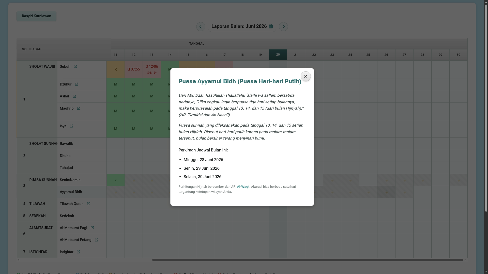

# amalanyaumiyah.xo.je

## command git ftp push
```pwsh
git ftp push
```

## jangan lupa commit dulu sebelum push
```pwsh
git add .
git commit -m "update"
```

## Install PHP
```pwsh
# Download and install PHP.
powershell -c "& ([ScriptBlock]::Create((irm 'https://www.php.net/include/download-instructions/windows.ps1'))) -Version 8.5"
```

## Run PHP
```pwsh
php -S localhost:8000
http://localhost:8000
```

## Cek php error
```pwsh
php -l index.php
```

## Login admin
Kredensial admin dibuat sekali dengan skrip:
```pwsh
./create-admin.sh
```
Hasilnya `test/admin.json` berisi username + password terenkripsi (AES-256-GCM).
File itu tidak ikut ke GitHub, tetapi ikut ke server FTP lewat `.git-ftp-include`.
`test/admin.php` menampilkan halaman login selama belum masuk. Skrip menolak
berjalan bila `admin.json` sudah ada — hapus dulu jika ingin membuat ulang.

Kunci kredensial **tidak ditulis apa adanya** di `admin.json`. Skrip membungkusnya
dengan bahan internal yang ditempel (disamarkan) ke `test/admin.php` pada konstanta
`ADM_ASSET_REV` (terlihat seperti revisi cache aset, sekaligus dipakai untuk
cache-busting ikon). Jadi menyalin `admin.json` saja tidak cukup untuk membuka
kredensial; `admin.php` juga dibutuhkan.

Sesi login diikat ke file `admin.json`. Bila file itu dihapus, rusak, atau dibuat
ulang, sesi lama otomatis gugur — admin yang masih membuka halaman akan diminta
masuk lagi.

## Pembuat nama panggilan (tool mandiri)
Panel di halaman admin (kode mandiri di dalam `admin.php`): masukkan nama lengkap →
muncul usulan nama panggilan beserta status tersedia/dipakai. Dicek terhadap semua
nama mentee (semua grup + tempat sampah), mentee yang tidak lagi mentoring, dan nama grup.
Tanpa angka, dan tidak mengubah apa pun.

## Tempat sampah & "tidak lagi mentoring"
Struktur seragam: `.DEPRECATED/<grup>/<mentee>/`. Folder `.DEPRECATED/<grup>` = grup yang
**tidak aktif** di root; menteenya bisa masih ada (sekadar belum diatur), jadi semuanya tetap ditampilkan.

- Panel Tempat Sampah menampilkan **tiap grup di `.DEPRECATED` beserta daftar menteenya** (seperti sebelumnya),
  dengan penanda **grup aktif** / **grup tidak aktif**.
- Grup **tidak aktif**: ada tombol **Pulihkan grup** (memindahkan `<grup>` kembali ke root).
- Setiap mentee di `.DEPRECATED` punya tombol **Pulihkan** dan **Tidak lagi mentoring**:
  - **Pulihkan** (grup tujuan sudah aktif di root): mentee dikembalikan ke grup itu.
  - **Pulihkan** (grup tujuan masih tidak aktif): grup `<grup>` dipulihkan ke root **berisi mentee ini saja**
    (file tingkat grup disalin dari `.DEPRECATED/<grup>`), mentee lain di grup itu tetap di tempat sampah.
  - **Tidak lagi mentoring** → memindahkannya ke `.DEPRECATED/.OUT/`.
- **Tidak lagi mentoring**: `.DEPRECATED/.OUT/<mentee>/`. Tampil di bagian "Tidak lagi mentoring" dengan
  **warna khusus** (violet) dan tombol **Aktif kembali** + dropdown grup tujuan.
  - Dropdown berisi **semua grup** (aktif di root maupun yang ada di `.DEPRECATED`).
  - Memilih grup yang ada di `.DEPRECATED` **tidak** memulihkan grupnya; menteenya cukup ditaruh di situ
    (opsi ditandai `(tidak aktif)`).
  - Manifest hanya dibuat ulang bila grup tujuannya aktif di root.
- Jadi tombol **Aktif kembali** hanya untuk mentee berstatus tidak lagi mentoring; mentee yang sekadar
  dihapus cukup memakai **Pulihkan**.

## Catatan

### Completed
- `admin.php`: salinan manifest lokal di `test/_manifest/` kini **dipangkas otomatis** (`adm_prune_local_manifests()`). Setiap kali manifest ditulis (juga saat mentee/grup dihapus, ditandai "tidak lagi mentoring", atau grup dihapus), file `manifest_*.json` yang tidak lagi cocok dengan grup aktif + menteenya akan dibuang. `manifest_test.json` selalu dipertahankan. Grup yang dipulihkan akan membuat ulang manifest grup + menteenya. Ini mencegah folder menumpuk sisa mentee/grup yang sudah dihapus (yang bisa ikut menumpuk di server bila panel dipakai di server).
- `admin.php`: perbaiki tombol **Uji koneksi** & **Daftar file di repo** yang seolah "tidak menghasilkan apa-apa". Penyebabnya: (a) aksi ini mengembalikan `ok:true` sehingga JS memuat ulang halaman 0,7 dtk kemudian dan menghapus pesannya, dan (b) hasilnya hanya muncul di `#msgs` di atas halaman, jauh dari tombol. Kini kedua tombol bertanda `data-noreload` (tak memuat ulang halaman) dan area pesan otomatis di-scroll ke tampilan. Saat menunggu, muncul "Memproses…" lebih dulu (panggilan GitHub bisa perlu beberapa detik). Hasil **Daftar file di repo** juga akhirnya dirender ke panel "3. Isi repo" (`#gh-files`) lengkap dengan tautan raw — sebelumnya `d.files` dari server tidak pernah ditampilkan.
- `admin.php`: perbaiki tombol **Simpan token**. Sebelumnya JS mengirim isi kolom token sebagai field `name` (bukan `token`), jadi server menganggap token kosong → token lama ikut terhapus lalu halaman dimuat ulang tanpa perubahan ("malah refresh, tak ada yang berubah"). Kini tombol memakai `data-from-field="token"` sehingga field yang dikirim benar; verifikasi gagal tidak lagi memuat ulang halaman sehingga pesan error tetap terbaca dan isian token tidak hilang.
- `admin.php`: token GitHub kini menerima **fine-grained** (`github_pat_...`) maupun **classic** (`ghp_...`). Sebelumnya validasi hanya menerima classic sehingga token fine-grained selalu ditolak ("Format token tidak dikenali") walau tetap di-commit/di-uji lewat API. Verifikasi saat menyimpan kini mengecek akses ke repo manifest + izin tulis (Contents: Read and write), dengan pesan error yang menyebut langkah perbaikan untuk fine-grained (pilih repo di "Only select repositories"). Panel menampilkan jenis token yang tersimpan.
- `create-admin.sh` + `admin.php`: kredensial admin dienkripsi AES-256-GCM di `test/admin.json`, tetapi **kunci kredensial tidak ditulis apa adanya** — dibungkus dengan bahan internal yang ditempel (disamarkan) ke `admin.php` sebagai konstanta `ADM_ASSET_REV` (berkedok revisi cache aset, sekaligus dipakai untuk cache-busting ikon). Jadi `admin.json` saja tidak cukup untuk membuka kredensial. `create-admin.sh` menolak berjalan bila `admin.json` sudah ada.
- `admin.php`: sesi login diikat ke sidik jari `test/admin.json`; menghapus/mengganti file kredensial otomatis mengeluarkan sesi yang masih aktif.
- `admin.php`: `.DEPRECATED/.OUT/` = mentee yang **tidak lagi mentoring**. Tampil di panel Tempat Sampah dengan warna khusus (violet) + tombol **Aktif kembali**; dropdown grup memuat **semua grup** (aktif + yang di `.DEPRECATED`), dan memilih grup di `.DEPRECATED` tidak memulihkan grupnya (manifest hanya dibuat ulang bila grup aktif di root). Tombol **Tidak lagi mentoring** muncul untuk mentee di `.DEPRECATED`; namanya juga ikut dicek agar tidak jadi usulan duplikat di tool nama panggilan.
- `admin.php`: panel Tempat Sampah menampilkan **tiap grup di `.DEPRECATED` beserta daftar menteenya** (seperti sebelumnya), dengan penanda grup aktif/tidak aktif, tombol **Pulihkan grup** (grup tidak aktif) dan **Pulihkan** + **Tidak lagi mentoring** di tiap baris mentee. **Pulihkan** pada mentee dari grup tidak aktif akan memulihkan grupnya ke root berisi mentee itu saja.
- `admin.php`: tool mandiri **Pembuat Nama Panggilan** dari nama lengkap (blok kode tersendiri di dalam `admin.php`, ditampilkan sebagai panel di halaman admin). Menampilkan beberapa usulan (kata, inisial, gabungan) beserta status tersedia/dipakai, dicek terhadap semua nama mentee (semua grup + tempat sampah) dan nama grup; tanpa angka. Tidak terhubung ke fitur lain (tidak menyimpan/mengubah apa pun).
- `admin.php`: grup baru tidak lagi otomatis membuat `target_settings.json`; file itu dibuat hanya saat target disimpan dari editor "Target & analisis" (grup tanpa file itu tetap jalan lewat fallback analisis).
- `admin.php`: tambah tombol **Hapus grup** → memindahkan seluruh grup beserta menteenya ke `.DEPRECATED/<grup>/` (dengan konfirmasi) dan bagian "Grup di tempat sampah" untuk memulihkannya. Struktur tempat sampah seragam: `.DEPRECATED/<grup>/<mentee>/`; bila folder `<grup>` sudah ada (mis. menteenya lebih dulu dihapus), isinya digabung.
- `admin.php`: perbaiki checkbox "mentor". Sebelumnya listener ganda (`click` + `change`) membuat aksi terkirim dua kali sehingga status kembali semula; kini input/select hanya pakai `change`.
- Perbaiki deteksi perubahan: mengembalikan data ke nilai sebelumnya kini dianggap "tidak ada perubahan", tombol Simpan ikut hilang (dipakai baseline pembanding terpisah dari cache lokal).
- `admin.php`: kartu Tempat Sampah collapse secara default.
- Template `index.php` grup & mentee tidak lagi memakai manifest placeholder; admin mengisi `$manifestPath` otomatis saat grup/mentee dibuat.
- Tambah manifest dasbor grup (`manifest_<grup>.json`) + tombol "Tulis manifest grup"; "Tulis SEMUA manifest" kini mencakup manifest grup.
- Pecah kode menggunakan Riverpod style (Modular ES Modules).
- Pecah kode berdasarkan fungsi, satu kode satu fungsi.
- Hapus file/kode yang tidak digunakan (`test/prayer_slider_handler.php`, `test/test_run.php`).

### Cancelled
buat layout penginputan lebih nyaman dengan membuat semuanya muat disatu layar, relayout, bagian penginputan data saya yang dibuat begitu
